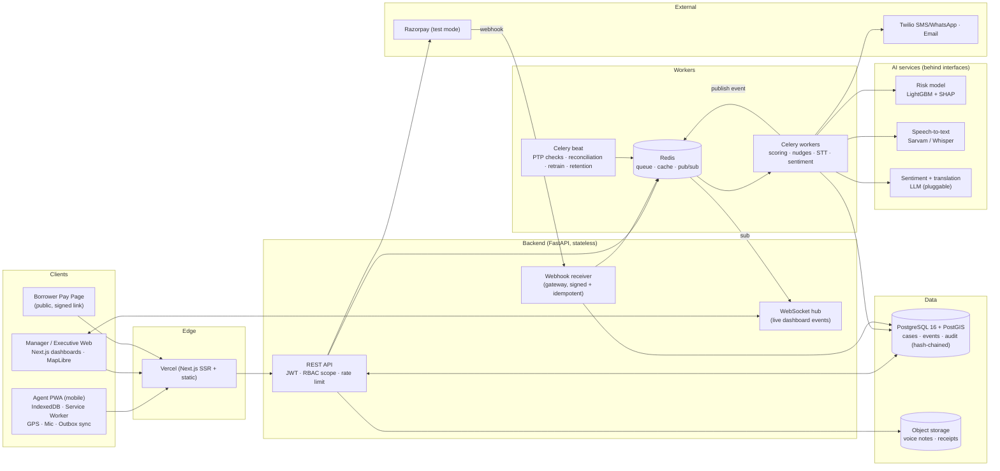
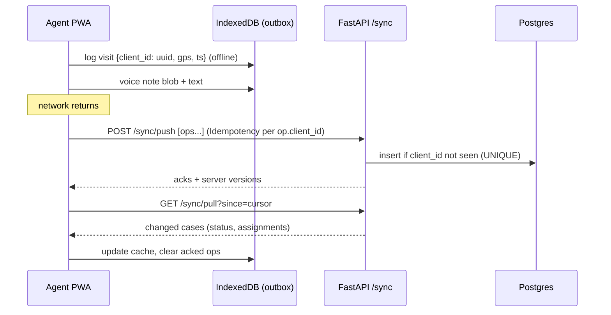
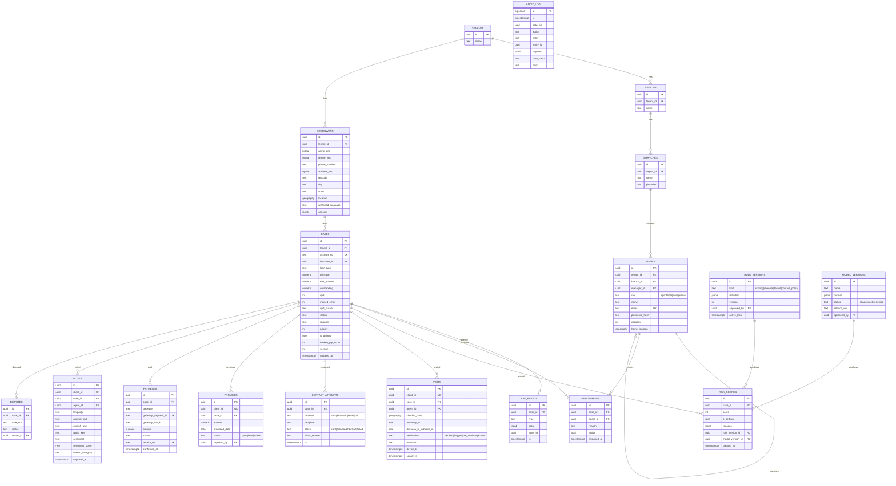

# RecoverIQ — Master Plan for QUASAR 5.0 (Round 0 → Round 1 → Grand Finale)

> **Hackathon:** QUASAR 5.0 · 36-Hour International Hackathon · VPPCOE & VA, Sion, Mumbai
> **Selected Problem Statement:** **PS-01 · FINTECH — AI-Powered Debt Collections Platform for Banks and NBFCs ("RecoverIQ")**
> **One-liner:** *"One case. One trail. Full visibility." RecoverIQ scores every overdue account, sends it to the right channel (field agent or digital self-cure), works offline on the agent's phone, marks a case paid only when the payment gateway confirms it, and records every action in a tamper-evident audit trail.*

This is the **single source of truth** for all rounds. When you say "do Round 0", I generate the Round 0 PPT from §14. When you say "do Round 1", I build the prototype and the Round 1 deck/demo from §15. For the finale I follow §16.

---

## Table of Contents

**Part A — Hackathon & Decision**
1. [Hackathon Facts (verified from Unstop + official site + PS PDF)](#1-hackathon-facts)
2. [Important Corrections Before We Start](#2-important-corrections-before-we-start)
3. [All Problem Statements, Compared](#3-all-problem-statements-compared)
4. [Why PS-01 Fintech (Decision)](#4-why-ps-01-fintech-decision)

**Part B — The Product**
5. [Problem Deep-Dive (Domain Research)](#5-problem-deep-dive)
6. [Users, Roles & Personas](#6-users-roles--personas)
7. [Solution Overview & Core Flows](#7-solution-overview--core-flows)
8. [Requirement Traceability Matrix (every PS requirement → our feature)](#8-requirement-traceability-matrix)
9. [System Architecture](#9-system-architecture)
10. [Tech Stack](#10-tech-stack)
11. [Module-by-Module Implementation](#11-module-by-module-implementation)
12. [Database Schema](#12-database-schema)
13. [API Design](#13-api-design)

**Part C — Round-by-Round Playbook**
14. [ROUND 0 — PPT Submission on Unstop (15–31 Dec 2026)](#14-round-0--ppt-submission-on-unstop)
15. [ROUND 1 — Online PPT Presentation (1–10 Jan 2027)](#15-round-1--online-ppt-presentation)
16. [ROUND 2 — Offline 36-Hour Grand Finale (23–24 Jan 2027)](#16-round-2--offline-36-hour-grand-finale)

**Part D — Engineering Quality & Execution**
17. [Security, Privacy & Compliance](#17-security-privacy--compliance)
18. [Scalability: Pilot → Multi-Region](#18-scalability-pilot--multi-region)
19. [Resilience & Live-Demo Safety](#19-resilience--live-demo-safety)
20. [Data Strategy (synthetic + live judge input)](#20-data-strategy)
21. [Repository Structure](#21-repository-structure)
22. [Environment Variables & Accounts Needed](#22-environment-variables--accounts-needed)
23. [Testing & CI](#23-testing--ci)
24. [Deployment](#24-deployment)
25. [Master Timeline: Today → Finale](#25-master-timeline-today--finale)
26. [Team Roles (2–4 members)](#26-team-roles)
27. [Judging Criteria → What We Show](#27-judging-criteria--what-we-show)
28. [Jury Q&A Defence Bank](#28-jury-qa-defence-bank)
29. [Risks & Mitigations](#29-risks--mitigations)
30. [Business Model & Roadmap](#30-business-model--roadmap)
31. [Sources](#31-sources)

---

# PART A — HACKATHON & DECISION

## 1. Hackathon Facts

| Item | Detail |
|---|---|
| Organiser | Vasantdada Patil Pratishthan's College of Engineering & Visual Arts (VPPCOE & VA), Sion, Mumbai. The PS PDF carries the **T&P (Training & Placement) cell** logo |
| Format | Offline final, 36 hours |
| Team size | **2–4 members** (individual entries not allowed) |
| Eligibility | Students **and working professionals** (per official Terms), inter-college/inter-org teams allowed |
| Fee | Free |
| Prize pool | ₹1,50,000 — **₹30,000 cash per problem statement winner** (5 PS slots; only 4 PS published so far) |
| Official site | quasar-vppcoe.vercel.app (tracks, timeline, terms) |
| Contact | quasar@pvppcoe.ac.in |

### Timeline (official)

| Date | Stage |
|---|---|
| 23 Oct 2026 | Registrations open |
| 1 Nov 2026 | Problem statements revealed |
| **15 Dec 2026 → 31 Dec 2026, 11:59 PM** | **Round 0: PPT submission on Unstop** ("No late submissions") |
| 31 Dec 2026 | Registration closes |
| **1 Jan → 10 Jan 2027** | **Round 1: Online PPT presentation, 5 minutes per team** (live evaluation; invites by email) |
| 11 Jan 2027 | Round 1 results |
| **23 Jan 2027, 8:00 AM → 24 Jan 2027** | **Final: 36-hour offline hackathon** — present to judges → get feedback → refine for 36 h → final demo, judging, awards |

### What each round asks for (verbatim requirements, summarised)

| Round | Requirement |
|---|---|
| **Round 0** | PowerPoint via Unstop: **identified problem, innovative solution, expected impact, brief introduction of team members, overview of beneficiaries, summary of progress.** Should show problem understanding, creativity and technical skill. Terms say use the **official template** |
| **Round 1** | Online PPT: **relevance & impact, engineering approach, technical feasibility, technologies involved.** Live 5-min slot covering **problem understanding, innovative approach, implementation strategy, expected outcomes** |
| **Round 2** | Present solution → receive judge feedback → refine during 36 h. Judged on **adaptability, creativity, technical expertise, real-time problem-solving, ability to implement improvements, innovation** |

### Official evaluation criteria (Terms §04)
**Innovation · Problem understanding · Technical feasibility · Implementation · Potential impact · Presentation quality.** Judges' decisions are final.

### Rules that shape our plan (Terms)
- Submissions must be **original**; acknowledge all third-party resources (we keep `CREDITS.md`).
- Respect IP and licences of code, datasets and APIs.
- Updates come via **Unstop, email and WhatsApp group** — check daily.
- Organisers may change schedule/format.

---

## 2. Important Corrections Before We Start

1. **The Round 0 submission is not tomorrow.** The Unstop window opens **15 Dec 2026** and closes **31 Dec 2026, 11:59 PM IST**. We have about **6 weeks**. That's time to build a **real working prototype before Round 0**, which most teams won't have. Our "summary of progress" slide becomes our strongest slide.
2. **You need at least 2 team members** (team size 2–4). If you registered alone, add teammates on Unstop **before 31 Dec**.
3. **Official PPT template:** Terms say we must use the official template. It's not published yet; watch Unstop, email and the WhatsApp group. Our content (§14) drops into whatever template they release.
4. **Only 4 of 5 problem statements are published.** Prizes list PS-5, but `/tracks/t-5` is a 404. If PS-5 appears, re-check §3 quickly. Our choice stays valid unless PS-5 is clearly easier and less crowded.
5. **Ask the organisers (email quasar@pvppcoe.ac.in):** "Can teams bring a pre-built prototype to the 36-hour final and improve it, or must code start on-site?" The finale description ("present solutions… then refine… implement improvements") suggests a prototype is expected, but get it in writing. §16 covers both cases.

---

## 3. All Problem Statements, Compared

| | PS-01 Fintech (RecoverIQ) | PS-02 Waste (CompostIQ) | PS-03 EdTech (Placement) | PS-04 Vibration Harvesting |
|---|---|---|---|---|
| Type | **Pure software** (web + mobile + AI) | **Hardware + software**: ESP32, DS18B20, capacitive moisture sensor, HX711 load cell, motorized stirrer, water spray, physical bin installed in a housing society | Pure software (multi-tenant + AI agents) | **Pure hardware/electronics**: piezo/electromagnetic harvester, supercapacitor, 3.3 V regulator, vibration rig, BOM |
| Can we fully build it with code? | **Yes** | No: physical prototype + real sensor data mandatory | Yes | No: lab measurements mandatory |
| Spec clarity | **Very high**: 18 essential requirements in a table, each testable | High but hardware-heavy | High but **huge**: student dashboard (8) + admin (11) + multi-tenancy, DPDP, fairness, NAAC/NIRF, ESCO/O*NET/NSQF, W3C VC | High |
| Expected competition | **Medium.** Collections is unfamiliar to most students, so fewer teams pick it, and those who do often build shallow CRUD | Low (hardware barrier) | **Very high.** Every student understands placements, and "agentic AI" attracts teams | Low (hardware barrier) |
| Live demo wow | **Very high**: judge pays a test link on their own phone → case flips to PAID only after gateway webhook; agent phone goes offline and syncs; Hindi/Marathi voice note → sentiment map | Medium–high (needs working hardware on the day) | Medium (dashboards, resume generation) | Medium (multimeter readings) |
| Cost | ~₹0 (free tiers, test-mode payments) | ₹3,000–8,000 hardware + build time | ~₹0 | ₹2,000–6,000 + rig |
| Risk of failure | Low–medium | High (hardware fails in transport/demo) | Medium (scope too wide) | High |

---

## 4. Why PS-01 Fintech (Decision)

**Decision: PS-01 FINTECH — RecoverIQ.**

1. **Each PS has its own ₹30,000 winner**, so we only compete inside our PS. The best PS is the one where **our execution beats the field**, not the "coolest" one.
2. **PS-02 and PS-04 are disqualified for us.** They require physical prototypes with real sensor/electrical measurements. Code can't satisfy them, and a hardware failure on demo day sinks you.
3. **PS-03 vs PS-01:** both are software, but:
   - **PS-03 will be the most crowded track.** Every student lives the placement problem, so many teams will pick it, and its scope (multi-tenant RLS, DPDP, fairness audits, NAAC/NIRF exports, W3C credentials, mock tests, AI agents) is too wide to finish well. Judges will see many half-built versions.
   - **PS-01 has a crisp, checkable spec** (18 essential requirements). A team that ticks **all 18 in a live demo** stands out because judges can verify each one.
   - **PS-01 suits engineering-heavy proof points** judges love: idempotent payment webhooks, offline-first sync, a tamper-evident audit log, explainable risk scores, compliance rules (RBI calling hours) enforced in code.
   - **PS-01 has the best live moment of any track:** a judge scans a QR, pays ₹1 in Razorpay test mode, and watches the case turn PAID on the manager dashboard **only after the webhook arrives**, exactly what the PS demands ("never shown as paid until the payment system confirms").
4. **Industry relevance:** retail loan stress is real (RBI's Financial Stability Report flagged that retail non-home loans made up about 40% of fresh NPAs in FY24, much of it via NBFC/fintech digital lenders), and RBI has tightened recovery-agent conduct (no calls before 8 AM or after 7 PM). Lenders want exactly this product (Credgenics and similar startups exist), which supports our impact and business slides.
5. **"AI encouraged, rules equally acceptable"** (PS text). We use **both**: a transparent rule scorecard as the base (always explainable) plus an ML model with SHAP reasons on top. We win on explainability either way.

**Runner-up:** PS-03 EdTech. Switch only if the published PS-01 spec changes drastically.

---

# PART B — THE PRODUCT

## 5. Problem Deep-Dive

**How collections work today at a typical NBFC branch:**
- Overdue lists come from the core lending system as **Excel**, split among agents by hand (often by whoever is free).
- Every overdue account is treated alike: a ₹4,000 account 5 days late gets the same visit as a ₹4 lakh account 85 days late.
- Field agents report by phone or WhatsApp at day's end. Managers **can't see who visited whom**, or whether the visit happened.
- Promises-to-pay ("I'll pay on the 10th") live in notebooks. **Broken promises go unnoticed** for weeks.
- Payment status is often updated manually, causing **double-posting** and **"marked paid but money never arrived"** errors.
- **Compliance is hard to prove.** RBI requires fair practices (no harassment, contact only 8 AM–7 PM), but there's no reliable log of who contacted whom, when, and how.

**Consequences:** slow recovery, high **cost-to-collect**, agent burnout, regulatory risk, unhappy borrowers.

**Key DPD (Days Past Due) buckets used in Indian lending:**
| Bucket | DPD | Meaning |
|---|---|---|
| X / Current | 0 | Not overdue |
| Bucket 1 / SMA-0 | 1–30 | Early delinquency, high self-cure chance |
| Bucket 2 / SMA-1 | 31–60 | Needs contact |
| Bucket 3 / SMA-2 | 61–90 | High risk |
| NPA | > 90 | Non-performing asset (default) |

These buckets drive our **default classification rule** (configurable, e.g. "≥ 3 missed EMIs OR DPD > 90 → DEFAULT").

---

## 6. Users, Roles & Personas

Role hierarchy from the PS: **Agent → Level-2 Manager → Level-1 Manager → Executive** (plus system Admin).

| Role | Scope | Main screens |
|---|---|---|
| **Field Agent** (mobile) | Only their assigned cases | Prioritised worklist, case detail, call/visit log, GPS check-in, voice note, collect payment, sync status |
| **Level-2 Manager** (team lead / branch) | Their team's agents & cases | Team queue, allocation & reassignment, PTP tracker, escalations, live field map |
| **Level-1 Manager** (region / zone) | All branches in region | Region dashboard, ageing, collection rate, agent performance, disputes |
| **Executive** (HQ) | Whole portfolio, **masked PII by default** | Portfolio KPIs, cost per recovery, state/city sentiment map, compliance report |
| **Admin** | Config | Rules (scoring, channel thresholds, default rule, quiet hours, frequency caps), users, data retention |
| **Borrower** (no login) | Their payment link only | Secure pay page, receipt |

---

## 7. Solution Overview & Core Flows

### The lifecycle of one case (our demo story)
```
CSV intake ──► dedupe (1 case/account) ──► risk score + reasons ──► channel decision
   │                                                                  │
   │                     ┌──────────── HIGH risk ─────────────────────┤
   │                     ▼                                            ▼ LOW risk
   │           allocation (pin code + DPD + proximity        digital self-cure:
   │           + performance + workload)                     SMS / WhatsApp / email nudge
   │                     │                                    (quiet hours + frequency caps)
   │                     ▼                                            │
   │           agent worklist (offline-capable)                       │
   │           GPS check-in → visit log → voice note                  │
   │           → promise-to-pay OR on-spot payment link               │
   │                     │                                            │
   │                     └──────────────► payment gateway ◄───────────┘
   │                                         │ webhook (signed)
   │                                         ▼
   │                         case = PAID only after confirmation (idempotent)
   │                                         │
   └──── every step ──► tamper-evident audit log ──► dashboards / learning loop
```

### Flow details
1. **Case Intake:** upload CSV/Excel (or API push). `account_no` is unique, so re-uploads **upsert**, never duplicate. An intake report shows created / updated / rejected rows with reasons.
2. **Risk Scoring:** every case gets a 0–100 score + **top 3 reason codes** ("DPD 74 days (+25)", "2 broken promises (+15)", "Unreachable last 3 attempts (+10)"). Recomputed on events (payment, broken promise, new DPD).
3. **Channel Decision:** configurable thresholds (e.g. score ≥ 70 or outstanding ≥ ₹1 L → FIELD; 40–69 → TELE/agent call; < 40 → DIGITAL self-cure). Versioned rules; every decision stores the rule version used.
4. **Allocation:** cases go to agents by **pin code + DPD bucket** (PS essential), weighted by **proximity, agent performance in that bucket, and current workload**. Managers can reassign; a **rebalance** button evens out workloads.
5. **Agent App:** prioritised worklist, full case history, call & visit logs, **GPS + timestamp check-in**, works **offline** and syncs safely.
6. **Digital Nudges:** templated SMS/WhatsApp/email in the borrower's language with a **secure payment link**. The **Contact Policy Engine** enforces quiet hours (8 AM–7 PM), daily/weekly caps, opt-outs. Blocked attempts are logged with a reason.
7. **Payments:** on-spot payment link/QR from the agent's phone or the nudge link → gateway → **signed webhook** → case PAID. Duplicate webhooks are ignored (unique `gateway_payment_id`). Instant digital receipt to the borrower.
8. **Promise-to-Pay & Escalation:** PTP with date/amount. A scheduler checks at due date + grace; unpaid → **BROKEN** → auto next action (field visit / L2 escalation). **Disputes** route to the dispute owner queue.
9. **Borrower Note Capture:** agent types or speaks; **speech-to-text in local languages** (Hindi, Marathi, etc.), saved with timestamp, original-language text + English translation.
10. **Sentiment:** each note gets a sentiment (positive / neutral / negative + "reason category": job loss, medical, willful, dispute…). Aggregated **per borrower, city and state** on an India map.
11. **Dashboards & Leaderboard:** collection rate, ageing, cost per recovery, agent performance, live field activity. Leaderboard computed **only from gateway-confirmed payments and GPS-verified visits**, so rankings can't be fabricated.
12. **Learning Loop:** outcomes (paid, PTP kept/broken, unreachable) feed a nightly model retrain. The new model runs in **shadow mode** and goes live only after **manager approval**; old model kept for rollback.

---

## 8. Requirement Traceability Matrix

Every requirement from the PS PDF → how we satisfy it → where we prove it. **We show this table in Round 1 and the finale: "18/18 essential requirements covered."**

| # | PS Essential Requirement | Our implementation | Proof in demo |
|---|---|---|---|
| 1 | **Case Intake** — one case per account, no duplicates | CSV/XLSX upload + API; `UNIQUE(account_no)`; upsert; intake report | Upload same CSV twice → 0 new cases |
| 2 | **Risk Scoring** — score with reasons, ranked queue | Rule scorecard + LightGBM with SHAP; top-3 reason codes; queue sorted by priority | Open case → reasons panel |
| 3 | **Channel Decision** — high → field, low → digital | Versioned threshold rules; decision + rule version stored | Change threshold → cases re-route |
| 4 | **Case Allocation** — pin code + DPD bucket, reassignment, workload balance | Weighted assignment (pin/proximity, bucket skill, load); reassign + rebalance | Rebalance button evens bar chart |
| 5 | **Agent Mobile App** — worklist, history, call & visit log | Installable PWA (Next.js) on any phone | Judge opens on their phone |
| 6 | **Visit & Location Tracking** — time + GPS at check-in | Geolocation + server timestamp; distance-to-address check; flag if > 300 m or low accuracy | Check-in appears on manager map live |
| 7 | **Digital Nudges** — SMS/WhatsApp/email + secure link, caps, quiet hours | Contact Policy Engine; Twilio (SMS/WhatsApp sandbox) + email; signed short links | Try nudge at "8:30 PM" (simulated clock) → blocked + logged |
| 8 | **Payment Collection** — on-spot or link, instant receipt | Razorpay Payment Links (test mode); UPI QR on agent app; PDF/email/SMS receipt | Judge pays ₹1 test |
| 9 | **Payment Confirmation** — paid only after gateway confirms, no double posting | Webhook signature verification; `UNIQUE(gateway_payment_id)`; reconciliation job; client can never set PAID | Replay webhook → no double posting |
| 10 | **Promise-to-Pay & Escalation** | PTP table + scheduler → BROKEN → next action / L2 escalation; dispute queue | Fast-forward clock → PTP breaks → escalation |
| 11 | **Manager & Executive Dashboards** | Collection rate, ageing, cost/recovery, agent performance, live field map (WebSocket) | Live updates during demo |
| 12 | **Offline Capability** | IndexedDB cache + outbox + service worker; idempotent sync; conflict rules | Airplane mode → log visit → reconnect → synced |
| 13 | **Simple Permissions** — Agent / L2 / L1 / Exec + masked data | RBAC + hierarchical scope; PII masked by default; "reveal" needs reason + is audited | Exec sees `98XXXXX321` |
| 14 | **Audit & Compliance** — every action logged, contact-time & fair-practice rules | Append-only, hash-chained audit log; DB blocks UPDATE/DELETE; compliance report | "Verify chain" button → ✅; tamper → ❌ |
| 15 | **Default Classification** — configurable rule | Rule DSL (e.g. `missed_emis >= 3 OR dpd > 90`), versioned | Edit rule → reclassify |
| 16 | **City & State Sentiment View** — borrower, city, state | Note sentiment → aggregates → India choropleth + drill-down | Map colours change after a new note |
| 17 | **Borrower Note Capture** — typed or voice, multi-language STT, timestamp | MediaRecorder → STT (Sarvam Saaras / Whisper fallback) → original + English text | Speak Hindi/Marathi live |
| 18 | **Single shared case record** — consistent status across views; never paid/closed until confirmed | One `cases` row as source of truth; state machine; WebSocket broadcast | Same case open on 3 screens updates together |
| + | **Learning Loop** — outcomes feed scores, explainable, manager review | Nightly retrain → shadow → approve → activate; model registry | Model page with versions |
| + | **Leaderboard** — no fabricated rankings | Computed from confirmed payments + verified visits only | Leaderboard explains each point |
| + | **Security + Privacy** — least privilege, encryption, masking, retention | §17 | Security slide |
| + | **Pilot → multi-region scalability** | §18 | Architecture slide |

---

## 9. System Architecture



**Design principles (say these to judges):**
- **One source of truth:** `cases` row + append-only `case_events`. Every screen reads the same record; status changes only through a **state machine** in the backend.
- **Payment truth comes only from the gateway.** The client never sets PAID. Webhook = truth; a reconciliation job catches missed webhooks.
- **Everything async that can fail** (SMS, STT, scoring) goes through a queue with retries, so the API stays fast.
- **Offline-first agent app:** writes go to a local outbox with client-generated UUIDs, and the server applies them idempotently.
- **Compliance as code:** a Contact Policy Engine sits in front of every outbound contact.
- **Tamper-evident audit:** each audit row stores `hash = SHA256(prev_hash ‖ row_payload)`, so any edit breaks the chain.

### Case state machine
```mermaid
stateDiagram-v2
    [*] --> NEW: intake
    NEW --> SCORED: risk scored
    SCORED --> DIGITAL: low risk
    SCORED --> FIELD: high risk
    DIGITAL --> FIELD: no response / PTP broken
    FIELD --> PTP: promise recorded
    DIGITAL --> PTP: promise via link page
    PTP --> PAYMENT_PENDING: link opened / payment initiated
    FIELD --> PAYMENT_PENDING
    DIGITAL --> PAYMENT_PENDING
    PAYMENT_PENDING --> PAID: gateway webhook confirmed
    PAYMENT_PENDING --> FIELD: payment failed
    PTP --> BROKEN_PTP: due date + grace passed
    BROKEN_PTP --> ESCALATED: auto next action
    FIELD --> DISPUTED: borrower disputes
    DISPUTED --> FIELD: resolved
    ESCALATED --> FIELD
    PAID --> CLOSED: full dues settled
    FIELD --> DEFAULT: default rule matched
    CLOSED --> [*]
```
Rule: transition to `PAID`/`CLOSED` is **only** allowed from the webhook handler / reconciliation service.

### Offline sync sequence

Conflict rules: visits, notes and PTPs are **append-only** (no conflicts). Assignment and status are **server-authoritative** (server wins). Payment status is never written offline.

---

## 10. Tech Stack

| Layer | Choice | Why |
|---|---|---|
| Web + Agent app | **Next.js 14 (App Router) + TypeScript** | One codebase for manager web and agent PWA |
| UI | **Tailwind CSS + shadcn/ui + Lucide** | Fast, polished, consistent |
| Charts | **Recharts** | Dashboards |
| Maps | **MapLibre GL JS** + OSM tiles + India states/cities GeoJSON | Live field map + sentiment choropleth |
| Offline | **Dexie.js (IndexedDB) + Workbox service worker** (next-pwa) | Cache + outbox + background sync |
| Client state/data | **TanStack Query** | Caching, retries, optimistic UI |
| Realtime | **WebSocket** (FastAPI) via Redis pub/sub | Live dashboard and multi-screen consistency |
| Backend | **FastAPI (Python 3.11) + Uvicorn** | Async, auto OpenAPI docs, same language as ML |
| ORM / migrations | **SQLAlchemy 2.0 + Alembic** | Typed models, versioned schema |
| Validation | **Pydantic v2** | Strict schemas |
| Jobs | **Celery + Redis + Celery beat** | Retries, schedules (PTP checks, reconciliation, retrain, retention) |
| DB | **PostgreSQL 16 + PostGIS** (Supabase/Neon) | Relational + geo (proximity, geofence) |
| Storage | **Supabase Storage / Cloudflare R2** (S3 API) | Voice notes, receipts |
| ML | **scikit-learn, LightGBM, SHAP, pandas** | Risk model + explanations |
| STT | **Sarvam AI Saaras v3** (22 Indian languages) → fallback **Whisper** (local/faster-whisper) → fallback browser Web Speech API | Hindi/Marathi/Tamil… voice notes |
| NLP | LLM via provider-agnostic interface (e.g. Claude `claude-haiku-5-5` for cheap high-volume sentiment/translation) + rule-based fallback | Sentiment + reason category + English translation |
| Payments | **Razorpay Test Mode** — Payment Links API + webhooks; UPI QR | India-native, free test mode |
| Messaging | **Twilio** (SMS + WhatsApp sandbox), **Resend/SendGrid** (email); **Notification Simulator** inbox for demo | See §29 on India SMS DLT rules |
| Receipts | **WeasyPrint/ReportLab** PDF | Instant digital receipt |
| Auth | Own JWT (access 15 min + refresh), **Argon2id** | Explainable, no black box |
| Security libs | `cryptography` (AES-GCM field encryption), `slowapi` (rate limits) | PII protection |
| Observability | Structured JSON logs + request IDs, `/health` `/ready`, Sentry (optional) | Debug live |
| Tests | **pytest**, httpx, **Playwright** e2e, **Locust** load test | Quality + scalability proof |
| CI | **GitHub Actions** | Lint + test on every push |
| Containers | **Docker + docker-compose** | One-command local stack; offline demo backup |
| Hosting | Vercel (web) · Render/Railway (API + workers) · Supabase/Neon (Postgres) · Upstash (Redis) | Free tiers |

---

## 11. Module-by-Module Implementation

### 11.1 Case Intake
- Upload `.csv/.xlsx` → validate columns (`account_no, borrower_name, phone, email, address, pincode, city, state, lat, lng, loan_type, principal, emi_amount, outstanding, dpd, missed_emis, last_payment_date, preferred_language`).
- Normalise: phone to E.164, pincode 6 digits, geocode if lat/lng missing (offline pincode→lat/lng table).
- `INSERT … ON CONFLICT (tenant_id, account_no) DO UPDATE` → **exactly one case per account**.
- Intake report: created / updated / skipped / errors (row number + reason). Large files processed as a background job with progress.

### 11.2 Risk Scoring (explainable)
**Layer 1: Rule scorecard (always on, fully explainable)**

| Factor | Points |
|---|---|
| DPD 1–30 / 31–60 / 61–90 / > 90 | +5 / +15 / +25 / +35 |
| Missed EMIs (each, max 4) | +5 |
| Outstanding ≥ ₹1 L / ≥ ₹5 L | +5 / +10 |
| Broken PTPs (each, max 3) | +5 |
| Unreachable last 3 attempts | +10 |
| Negative sentiment (willful) | +10 |
| Paid something in last 30 days | −10 |
| Kept last PTP | −10 |

Score capped 0–100; each case stores `reasons: [{code, label, points}]`.

**Layer 2: ML (probability of self-cure in 30 days)**
- Features: DPD, missed EMIs, outstanding/EMI ratio, loan type, past payment regularity, contact success rate, PTP history, sentiment, tenure.
- Model: **LightGBM** (or logistic regression baseline), trained on a **public credit-default dataset** (e.g. UCI "Default of Credit Card Clients", CC BY 4.0) mapped onto our features + our synthetic outcome history; later on real outcomes.
- **SHAP** values → top 3 human-readable reasons.
- **Final priority** = `0.6 × risk_score + 0.3 × amount_at_stake_pct + 0.1 × dpd_norm` (weights configurable).
- Model registry: `model_versions` with metrics (AUC, precision@k), status `shadow | active | retired`. **Manager approves activation.**

### 11.3 Channel Decision
- Rule config (versioned JSON): `FIELD if score ≥ 70 OR outstanding ≥ 100000; TELE if 40 ≤ score < 70; DIGITAL otherwise`.
- Overrides by manager (logged with reason).
- Every decision stores `rule_version` + inputs, so it is reproducible.

### 11.4 Allocation & Workload Balancing
For each case needing FIELD/TELE, compute for each eligible agent (same pincode cluster / within radius):
```
fit(agent, case) = 0.45·proximity + 0.30·bucket_performance + 0.25·(1 − load/capacity)
proximity = 1 − min(distance_km / R, 1)          (PostGIS ST_Distance)
bucket_performance = agent's recovery rate in this DPD bucket (last 30 days, smoothed)
```
- Greedy assignment by case priority (highest-priority cases get best-fit agents first), respecting capacity.
- **Rebalance:** move lowest-priority cases from overloaded to underloaded agents in the same area.
- **Reassignment:** manager drag-and-drop with reason. Logged, and the agent app gets a push via sync.
- Stretch: OR-Tools min-cost-flow for globally optimal allocation.

### 11.5 Agent Mobile App (PWA)
- Screens: Login → **Today's worklist** (priority order, distance, chips: DPD, amount, PTP due) → Case detail (history timeline, contact info masked until check-in) → Actions: **Call** (tel: link + outcome form), **Check-in** (GPS), **Log visit outcome**, **Record note** (voice/text), **Record PTP**, **Collect payment** (QR/link), **Raise dispute**.
- Offline: Dexie stores worklist + case details; outbox queue; sync badge ("3 pending"); background sync on reconnect.
- Install prompt (Add to Home Screen). Stretch: wrap with Capacitor to ship an APK.

### 11.6 Visit & Location Tracking
- Check-in captures `lat, lng, accuracy, device_ts`; server adds `server_ts`.
- Validations: distance to borrower address (PostGIS) ≤ 300 m → **VERIFIED**, else **FLAGGED** (manager review); accuracy > 100 m → **LOW_CONFIDENCE**; impossible speed between check-ins (> 120 km/h) → **SUSPICIOUS**.
- Manager live map shows agent pins + visit trail of the day.

### 11.7 Digital Nudges + Contact Policy Engine
- Templates per language (en, hi, mr, …) with variables `{name} {amount} {due_date} {link}`.
- **ContactPolicy.check(borrower, channel, now)** → allow/deny + reason:
  - Quiet hours: allowed only **08:00–19:00** borrower local time (RBI guidance for recovery contact).
  - Frequency caps (configurable): e.g. max 1 SMS/day, 3/week; max 2 calls/day; no contact on opted-out channels.
  - Fair-practice: no contact to third parties/references; no messages after PAID.
- Denied attempts are queued for the next allowed window or dropped, always logged.
- Secure link: signed, expiring token (`/p/{token}`) → borrower pay page with masked details.

### 11.8 Payments (gateway-confirmed only)
- Create **Razorpay Payment Link** (test mode) per case/amount; store `gateway_link_id`.
- Webhook `/webhooks/razorpay`: verify `X-Razorpay-Signature` (HMAC-SHA256) → find case → insert payment with `UNIQUE(gateway_payment_id)` → transition `PAYMENT_PENDING → PAID` in one DB transaction → enqueue receipt → publish WebSocket event.
- Duplicate webhook → unique violation → ignore (**no double posting**).
- **Reconciliation job** every 10 min: fetch link/payment status from gateway API for pending cases (in case a webhook was missed).
- Partial payments supported (`amount_paid < due` → stays open with reduced outstanding).
- Receipt: PDF + email/SMS with receipt number.

### 11.9 Promise-to-Pay & Escalation
- PTP: `{case_id, promised_amount, promised_date, channel, captured_by}`.
- Beat job hourly: PTPs where `promised_date + grace (1 day) < now` and no matching payment → status **BROKEN** → increment `broken_ptp_count` → re-score → next action (DIGITAL → FIELD, or second broken → **escalate to L2 manager**).
- Disputes: category (wrong amount, already paid, fraud claim, service issue) → routed to the owner queue (ops/legal); case paused for nudges while disputed.

### 11.10 Borrower Note Capture (voice, multilingual)
- Record up to 30 s chunks (MediaRecorder, webm/opus) → upload (or queue offline) → worker → **STT** (Sarvam Saaras v3 with language auto-detect; fallback Whisper) → store `original_text`, `language`, `english_text`, `audio_url`, `captured_at`.
- Agent can edit the transcript before saving (edit logged).

### 11.11 Sentiment: Borrower → City → State
- For each note: LLM classifier (structured JSON output) → `sentiment ∈ {positive, neutral, negative}`, `score ∈ [−1,1]`, `reason_category ∈ {job_loss, medical, business_loss, family_event, dispute, willful_default, will_pay}`, plus a rule/keyword fallback when the LLM is unavailable.
- Aggregates (materialised view refreshed every 5 min): avg sentiment and % negative per **borrower, city, state**.
- UI: India state choropleth (green ↔ red) → click state → cities → borrowers. Tooltip: "Maharashtra: 62% positive repayment mood (n = 418 notes)".

### 11.12 Dashboards
| KPI | Definition |
|---|---|
| Collection rate | amount collected ÷ amount due (period) |
| Ageing | count and ₹ by DPD bucket (stacked bar) |
| Cost per recovery | (field visits × visit cost + SMS × cost + calls × cost) ÷ ₹ recovered (cost params configurable) |
| Agent performance | visits, verified visits %, PTPs taken, PTP kept %, ₹ collected |
| Live field activity | map of check-ins (WebSocket) |
| Roll rate | % of accounts moving to a worse bucket month over month |
| Digital self-cure rate | % of DIGITAL cases paid without a visit |

Role-restricted: each query is filtered by the user's scope (team/region/all).

### 11.13 Leaderboard (no fabricated rankings)
Points = ₹ collected (gateway-confirmed) + 5 × verified visits + 10 × kept PTPs. Each agent can tap their score to see exactly which payments/visits earned it.

### 11.14 Audit & Compliance
- `audit_log(id, ts, actor_id, role, action, entity, entity_id, payload_json, ip, prev_hash, hash)`.
- Postgres trigger rejects UPDATE/DELETE on `audit_log`; DB role for the app has INSERT/SELECT only.
- **Verify chain** endpoint recomputes hashes and reports the first broken link.
- Compliance report: contact attempts by hour (proves none outside 8–7), blocked attempts, PII reveals, reassignment reasons.

### 11.15 Default Classification
- Rule expression stored and versioned, e.g. `missed_emis >= 3 or dpd > 90`; evaluated with a **safe expression evaluator** (whitelisted fields/operators, no `eval`).
- Changing the rule triggers a reclassification job; each case stores which rule version flagged it.

### 11.16 Learning Loop
Nightly: export outcomes → retrain → evaluate vs active model on a hold-out → register as **shadow** → shadow scores logged side by side for a week (in demo: instantly) → manager clicks **Approve** → active. Rule weights for channel effectiveness also update (e.g. WhatsApp vs SMS response rate per bucket).

---

## 12. Database Schema



**Key constraints & indexes**
```sql
CREATE UNIQUE INDEX uq_case_account ON cases(tenant_id, account_no);       -- 1 case per account
CREATE UNIQUE INDEX uq_payment_gw   ON payments(gateway_payment_id);        -- no double posting
CREATE UNIQUE INDEX uq_visit_client ON visits(client_id);                   -- idempotent offline sync
CREATE UNIQUE INDEX uq_note_client  ON notes(client_id);
CREATE UNIQUE INDEX uq_ptp_client   ON promises(client_id);
CREATE INDEX ix_cases_queue   ON cases(tenant_id, status, priority DESC);
CREATE INDEX ix_cases_bucket  ON cases(dpd_bucket);
CREATE INDEX ix_borrower_geo  ON borrowers USING GIST(location);
CREATE INDEX ix_visits_agent  ON visits(agent_id, server_ts DESC);
CREATE INDEX ix_ptp_due       ON promises(status, promised_date);
CREATE INDEX ix_contact_case  ON contact_attempts(case_id, ts DESC);
-- audit_log: trigger blocks UPDATE/DELETE; app role has INSERT, SELECT only
```
`cases.version` is used for **optimistic locking**: concurrent manager edits can't silently overwrite each other.

---

## 13. API Design

Base `/api/v1` · JWT · role + scope checks · cursor pagination · error shape `{error:{code,message,request_id}}` · OpenAPI at `/docs`.

| Method | Endpoint | Roles | Purpose |
|---|---|---|---|
| POST | `/auth/login`, `/auth/refresh` | all | Tokens |
| POST | `/intake/upload` | admin, l1 | CSV/XLSX → job |
| GET | `/intake/jobs/{id}` | admin, l1 | Intake report |
| GET | `/cases?status&bucket&channel&agent&sort=priority` | scoped | Queue |
| GET | `/cases/{id}` | scoped | Case + timeline + scores + reasons |
| POST | `/cases/{id}/reveal-pii` | l2+ | Unmask (reason required, audited) |
| POST | `/cases/{id}/channel` | l2+ | Manual channel override |
| POST | `/allocation/run` | l2+ | Allocate unassigned |
| POST | `/allocation/rebalance` | l2+ | Balance workload |
| POST | `/cases/{id}/reassign` | l2+ | Reassign with reason |
| GET | `/agent/worklist` | agent | Prioritised list |
| POST | `/sync/push` · GET `/sync/pull?since=` | agent | Offline sync |
| POST | `/cases/{id}/visits` | agent | GPS check-in + outcome |
| POST | `/cases/{id}/notes` (multipart audio or text) | agent | Note capture |
| POST | `/cases/{id}/promises` | agent, l2 | PTP |
| POST | `/cases/{id}/payment-link` | agent, l2 | Create gateway link/QR |
| POST | `/cases/{id}/nudge` | l2+, system | Send nudge (policy-checked) |
| POST | `/webhooks/razorpay` | gateway (signed) | Payment confirmation |
| POST | `/cases/{id}/disputes` | agent, l2 | Raise dispute |
| GET | `/dashboards/summary?scope=` | l2, l1, exec | KPIs |
| GET | `/dashboards/sentiment?level=state|city|borrower` | l1, exec | Sentiment aggregates |
| GET | `/leaderboard` | all | Verified rankings |
| GET/POST | `/rules/{kind}` | admin | Versioned rules |
| GET/POST | `/models`, `/models/{id}/approve` | l1, admin | Learning loop |
| GET | `/audit?entity&actor` · GET `/audit/verify` | l1, exec, admin | Audit + chain check |
| GET | `/compliance/report` | exec, admin | Contact-hours report |
| GET | `/p/{token}` · POST `/p/{token}/promise` | public (signed) | Borrower pay page |
| WS | `/ws/events` | scoped | Live updates |
| GET | `/health`, `/ready` | — | Probes |

---

# PART C — ROUND-BY-ROUND PLAYBOOK

## 14. ROUND 0 — PPT Submission on Unstop

**Window:** 15 Dec 2026, 00:00 → **31 Dec 2026, 23:59 IST**. **Submit by 30 Dec** to avoid last-minute portal issues.
**Format:** PPT (official template when released) → upload on Unstop. Also export a PDF backup.
**Must contain (from Unstop):** problem · innovative solution · expected impact · team intro · beneficiaries · **summary of progress**.
**Judged on:** problem understanding, creativity, technical skill (+ Terms criteria).

### Our Round 0 advantage
By 15 Dec we'll have a **working MVP** (see §25). The deck includes **real screenshots**, a **live demo link** and a **60–90 s demo video** link. Most teams will submit ideas only.

### Round 0 deck: slide-by-slide (12 slides)

| # | Slide | Content |
|---|---|---|
| 1 | **Title** | RecoverIQ · "One case. One trail. Full visibility." · PS-01 Fintech · team name · logo |
| 2 | **Team** | 2–4 members: photo, name, college/year, role (Backend/ML, Frontend/Mobile, Data/Integrations, Product/Pitch), one relevant skill each |
| 3 | **The problem** | Spreadsheet allocation, no field visibility, every account treated alike, broken promises unnoticed, payment double-posting, compliance hard to prove. One strong stat: retail non-home loans ≈ 40% of fresh NPAs (RBI FSR, FY24) |
| 4 | **Root causes** | Fragmented tools (Excel, phone, WhatsApp) → no single case record → no prioritisation → no audit trail. Diagram "today vs RecoverIQ" |
| 5 | **Beneficiaries** | Lenders (banks, NBFCs, MFIs) · field agents · managers/executives · **borrowers** (fair, respectful contact, easy self-pay, no harassment) · regulators (provable compliance) |
| 6 | **Our solution** | 3 pillars from the PS: ① Risk-based prioritisation & channel decision ② Field enablement & digital self-cure ③ Manager/executive visibility. Lifecycle diagram (§7) |
| 7 | **What makes it innovative** | Explainable dual-layer scoring (rules + ML + SHAP) · gateway-confirmed payment truth · offline-first agent app · Contact Policy Engine (RBI 8 AM–7 PM, caps) · hash-chained tamper-evident audit · multilingual voice notes → state/city sentiment map · human-approved learning loop |
| 8 | **Architecture** | Diagram from §9 + tech logos |
| 9 | **Feature coverage** | Compact version of §8: "18/18 essential requirements mapped" |
| 10 | **Expected impact** | Faster recovery via prioritisation; lower cost-to-collect via digital self-cure; provable compliance; agent productivity. Frame as **targets for the pilot** (e.g. "target: 20–30% of low-risk cases self-cure digitally"), not as achieved results |
| 11 | **Progress so far** | Screenshots: worklist, risk reasons, manager dashboard, payment-confirmed flow · links: live demo, GitHub, 90 s video · checklist of what's built vs next |
| 12 | **Roadmap & scalability** | Pilot (1 branch) → region → multi-portfolio; Round 1 → Finale plan; thank you + contacts |

### Round 0 checklist
- [ ] Team size ≥ 2 on Unstop
- [ ] Official template used (if released)
- [ ] Deck ≤ 12–15 slides, readable fonts (≥ 18 pt body)
- [ ] Every claim either cited or labelled as "target"
- [ ] Live demo link + video link work in incognito
- [ ] `CREDITS.md` lists third-party libraries/APIs/datasets
- [ ] PPT + PDF uploaded before **30 Dec**

**Command to me:** *"Do Round 0"* → I generate the PPTX from this section with real screenshots from the MVP.

---

## 15. ROUND 1 — Online PPT Presentation

**Window:** 1–10 Jan 2027 (slot via email). **5 minutes** live, likely followed by questions.
**Judged on:** relevance & impact, **engineering approach, technical feasibility, technologies**, problem understanding, innovative approach, **implementation strategy**, expected outcomes.

### Strategy
Round 1 is about **engineering credibility**. We show **a working system**, not a promise: a 75–90 s embedded demo video (no live-network risk) plus architecture, data model and implementation plan.

### Round 1 deck (10 slides, 5 minutes)

| Time | Slide | Say |
|---|---|---|
| 0:00–0:25 | 1. Hook + title | "An NBFC agent starts the day with an Excel sheet of 300 overdue accounts and no idea which 20 matter. RecoverIQ fixes that." |
| 0:25–0:55 | 2. Problem & users | Pain per role (agent / manager / exec / borrower) |
| 0:55–1:20 | 3. Solution in one picture | Lifecycle diagram |
| 1:20–2:45 | 4. **Demo video (≈85 s)** | Intake → scores with reasons → channel split → agent app offline check-in + Hindi voice note → judge-style ₹1 payment → PAID only after webhook → dashboard + sentiment map |
| 2:45–3:20 | 5. Architecture | Stateless API, queue workers, webhook truth, offline sync, hash-chained audit |
| 3:20–3:45 | 6. Data model | ER diagram + 3 key constraints (one case/account, unique payment id, idempotent client ids) |
| 3:45–4:10 | 7. Explainable AI + compliance | Scorecard + SHAP, Contact Policy Engine, human-approved model updates |
| 4:10–4:35 | 8. Feasibility & implementation plan | What's built (✅) vs what we build in the 36 h (🔜), tech stack, team roles |
| 4:35–4:55 | 9. Impact & scale | Pilot → multi-region, cost per recovery, DPDP/RBI alignment |
| 4:55–5:00 | 10. Close | "One case. One trail. Full visibility." |

### Round 1 deliverables
- [ ] Deck (PPTX + PDF) per the email instructions
- [ ] 85 s demo video embedded (MP4) + YouTube unlisted backup
- [ ] Live app link ready to share if judges ask
- [ ] Rehearsed 5 times with a timer; each member knows the Q&A bank (§28)
- [ ] Quiet room, wired internet/hotspot backup, camera on, screen-share tested

**Command to me:** *"Do Round 1"* → I finish the prototype features needed, record-ready demo script, and generate the Round 1 deck.

---

## 16. ROUND 2 — Offline 36-Hour Grand Finale

**When/where:** 23 Jan 2027, 8:00 AM → 24 Jan 2027 · VPPCOE & VA, Sion (East), Mumbai.
**Format:** present solution → **judges give feedback** → 36 h refinement → final demo & judging.
**Judged on:** adaptability, creativity, technical expertise, real-time problem-solving, **implementing improvements**, innovation.

### Strategy
1. Arrive with a **deployed, polished MVP** (if organisers allow; see §2.5) plus the full local docker stack.
2. In the first judge session, **write down every piece of feedback**, then create a visible **"Feedback → Action" board** (GitHub Project).
3. Spend the 36 h on: (a) feedback items, (b) "wow" stretch features (§16.4), (c) hardening + demo rehearsal.
4. Final pitch includes a **"You said → We built"** slide. That's exactly what this round scores.

**If pre-built code is not allowed:** we arrive with the architecture, schema, seed data generator, UI design and a boilerplate repo, and follow the same 36 h plan with P0 features only (§16.3).

### 16.1 What to carry
- 2 laptops + chargers + extension board, 2 Android phones (agent app) + 1 iPhone if possible, mobile hotspot (2 SIMs, different carriers), USB-C/HDMI adapters
- Printed QR codes: agent app URL, borrower pay link, GitHub
- Offline copy: docker images, seeded DB dump, demo video, PDF decks
- Team ID, college ID, registration confirmation

### 16.2 Opening presentation (first judge session, ~3–5 min)
Same story as Round 1, but **live** (fallback to video). End with: *"Tell us what would make this deployable at your bank tomorrow. We'll build it in the next 36 hours."*

### 16.3 36-hour schedule

| Clock | Work |
|---|---|
| H0–H2 | Setup, Wi-Fi check, deploy check, judge presentation, **capture feedback** |
| H2–H3 | Triage feedback → prioritised backlog (must / should / could) |
| H3–H12 | Build feedback "musts" + stretch feature #1 |
| H12–H13 | Mentor round (if any) → re-prioritise |
| H13–H20 | Stretch #2, hardening, tests, load test (Locust) |
| H20–H24 | **Sleep in shifts** (2 × 2 h), CI green, nothing risky |
| H24–H30 | UI polish, dashboards, demo data story, compliance report |
| H30–H33 | **Code freeze**, deploy final, record backup video |
| H33–H36 | Final deck ("You said → We built"), rehearse demo 3×, assign roles on stage |

### 16.4 Stretch features to build at the finale (pick by feedback)
1. **AI voice-bot nudge** (IVR-style reminder call in Hindi/Marathi via TTS) for low-risk cases
2. **Next-best-action agent**: LLM suggests the next step per case with reasons, manager approves
3. **Geo-route optimiser** for the agent's day (visit order by priority × distance)
4. **Borrower self-service portal**: restructure request, upload proof of hardship → dispute/hardship queue
5. **Capacitor APK** of the agent app
6. **Fraud/anomaly flags**: same GPS for many visits, visits outside working hours, sudden spikes
7. **Regulatory export**: monthly compliance PDF (contact hours, complaints, PII access)

### 16.5 Final demo script (7 min)
1. **Intake (30 s):** upload CSV of 5,000 accounts, re-upload → 0 duplicates.
2. **Score & route (45 s):** open a case, show reasons; move channel threshold → cases re-route.
3. **Allocation (30 s):** rebalance → workload bars even out.
4. **Agent phone (90 s):** airplane mode → check-in (GPS) → Marathi voice note → PTP → back online → synced; manager map updates live.
5. **Payment truth (60 s):** **judge scans QR, pays ₹1 (Razorpay test)** → case shows PAYMENT_PENDING → webhook → PAID + receipt. Replay webhook → no double posting.
6. **Compliance (45 s):** try a nudge at simulated 9 PM → blocked + logged; "Verify audit chain" ✅; tamper one row in DB → ❌.
7. **Visibility (45 s):** exec dashboard, ageing, cost per recovery, state sentiment map, leaderboard with proofs.
8. **You said → We built (45 s).**
9. **Close (15 s).**

### 16.6 Final pitch deck outline
Title · Problem · Solution · Live demo (or video) · Architecture · Data model · Explainable AI & compliance · **You said → We built** · Scalability & business model · Impact · Team · Thank you.

**Command to me:** *"Do Round 2"* → I prepare the finale deck, demo checklist and stretch-feature code.

---

# PART D — ENGINEERING QUALITY & EXECUTION

## 17. Security, Privacy & Compliance

| Area | Control |
|---|---|
| Authentication | Argon2id hashes, JWT access (15 min) + rotating refresh (7 d), lockout after 5 failed attempts |
| Authorisation | RBAC (agent / l2 / l1 / exec / admin) + **hierarchical scope** filter in every query (agent → own cases, l2 → team, l1 → region, exec → all); tenant isolation by `tenant_id` (stretch: Postgres RLS) |
| PII protection | Name/phone/address encrypted at field level (AES-GCM, key in secret store); **masked by default** (`98XXXXX321`); reveal requires reason + audited |
| Transport | HTTPS only, HSTS, strict CORS allow-list |
| Payments | Webhook HMAC verification, idempotent posting, client cannot set PAID, amounts validated against case |
| Abuse | Rate limits per user/IP; signed, expiring borrower links |
| Audit | Append-only hash-chained `audit_log`; DB trigger blocks UPDATE/DELETE; chain verification |
| Retention | Configurable policy: closed cases anonymised after N years; voice notes deleted after N days; nightly retention job (logged) |
| DPDP Act 2023 + Rules 2025 alignment | Purpose limitation (collections only), notice text for borrower page, data-principal request handling (access/correction) in admin, breach-notification runbook, minimal data collection. DPDP Rules were notified in Nov 2025 with most obligations phasing in over 18 months |
| RBI fair practices | Contact only **08:00–19:00**, no harassment (templates reviewed, no threats), no third-party disclosure, every contact logged; recovery-agent identity shown on pay page |
| Secrets | `.env` never committed; platform secret stores; `.env.example` |

## 18. Scalability: Pilot → Multi-Region

| Stage | Scale | Setup |
|---|---|---|
| Pilot | 1 branch, 20 agents, ~5k cases | 1 API, 1 worker, managed Postgres, Redis |
| Region | 10 branches, 300 agents, ~100k cases | API autoscale (stateless), separate worker pools (scoring / messaging / STT), read replica for dashboards |
| Multi-region, multi-portfolio | 5k agents, ~5M cases | Partition `cases`/`case_events` by tenant + region; materialised KPI views / OLAP (ClickHouse) for dashboards; per-tenant keys & rate limits; message queues per channel; CDN for PWA |

**Load-test target (Locust, shown in the deck):** 500 concurrent agents syncing, p95 < 300 ms for worklist; 100 webhooks/s with zero double-posting.

## 19. Resilience & Live-Demo Safety

| Failure | Behaviour |
|---|---|
| Gateway webhook delayed/lost | Reconciliation job fetches status; UI shows "awaiting confirmation" (never fake PAID) |
| SMS/WhatsApp provider down | Retry with backoff; switch channel; **Notification Simulator** inbox shows exactly what would be sent |
| STT API down | Fallback to Whisper → fallback to typed note |
| LLM down | Rule/keyword sentiment fallback |
| Venue Wi-Fi down | Hotspot; agent app works offline by design; full docker stack on laptop |
| Cold start (free hosting) | Warm-up pings before judging; paid tier for finale day if needed |
| Bad CSV from a judge | Row-level validation errors, partial import, clear report |

## 20. Data Strategy

- **Synthetic portfolio generator** (`scripts/generate_portfolio.py`): Faker `en_IN`, 5,000–50,000 accounts across Mumbai/Pune/Nagpur/Thane etc., with real pincodes and lat/lng, loan types (two-wheeler, personal, gold, MSME), realistic DPD distribution, payment histories, preferred languages (mr/hi/en/gu).
- **Agents:** 20–50 synthetic agents with home locations and capacities.
- **Model training:** public credit-default dataset (UCI "Default of Credit Card Clients", CC BY 4.0) for behaviour patterns + synthetic outcomes; documented in `docs/ml.md`. **Never present synthetic results as real-world results.**
- **Live judge input:** judges upload their own CSV, pay real test-mode links, speak their own voice notes, so nothing is hardcoded.
- Geo data: India state/district GeoJSON (open data, licence noted in `CREDITS.md`).

## 21. Repository Structure

```
recoveriq/
├── README.md                 # badges, demo links, screenshots, architecture, setup, credits
├── CREDITS.md                # every third-party lib/API/dataset + licence (Terms §03, §06)
├── docker-compose.yml        # postgres+postgis, redis, api, worker, beat, web
├── .github/workflows/ci.yml
├── docs/
│   ├── architecture.md  database.md  api.md  ml.md  compliance.md  demo-script.md
│   └── images/
├── backend/
│   ├── Dockerfile  pyproject.toml  alembic/
│   ├── app/
│   │   ├── main.py  config.py  db.py
│   │   ├── models/  schemas/
│   │   ├── api/v1/  (auth, intake, cases, allocation, agent, sync, visits, notes,
│   │   │             promises, payments, webhooks, nudges, disputes, dashboards,
│   │   │             sentiment, leaderboard, rules, models, audit, compliance, public)
│   │   ├── core/    (security, rbac_scope, crypto, masking, rate_limit, errors, logging)
│   │   ├── domain/
│   │   │   ├── state_machine.py      # case transitions (PAID only from payment service)
│   │   │   ├── scoring/  (scorecard.py, ml_model.py, explain.py)
│   │   │   ├── channel.py  allocation.py  contact_policy.py  default_rule.py
│   │   │   ├── payments.py  ptp.py  sentiment.py  audit_chain.py  rule_eval.py
│   │   ├── integrations/ (razorpay.py, twilio.py, email.py, stt_sarvam.py, stt_whisper.py, llm.py)
│   │   └── ws/hub.py
│   ├── workers/ (celery_app.py, tasks_*.py, beat_schedule.py)
│   ├── scripts/ (generate_portfolio.py, seed.py, train_model.py)
│   └── tests/   (unit + api + webhook idempotency + policy + audit chain)
├── web/                      # Next.js: manager/exec web + agent PWA + borrower pay page
│   ├── app/ (login, dashboard, cases, allocation, map, sentiment, leaderboard, rules,
│   │         models, audit, compliance, agent/*, p/[token])
│   ├── components/  lib/ (api, auth, offline/dexie, sync, ws)
│   └── public/manifest.json  service-worker
└── loadtest/locustfile.py
```

## 22. Environment Variables & Accounts Needed

**Accounts you (the team) must create yourselves** (I can't create accounts or handle your real credentials; use **test/sandbox** keys only):
- Razorpay (**Test Mode** keys + webhook secret)
- Twilio trial (SMS + WhatsApp sandbox) and/or Resend/SendGrid (email)
- Sarvam AI API key (STT) · LLM API key (optional)
- Supabase or Neon (Postgres), Upstash (Redis), Vercel, Render/Railway, GitHub

```bash
# backend/.env.example
DATABASE_URL=postgresql+psycopg://...
REDIS_URL=redis://...
JWT_SECRET=change-me
PII_ENC_KEY=base64-32-bytes
RAZORPAY_KEY_ID=rzp_test_xxx
RAZORPAY_KEY_SECRET=...
RAZORPAY_WEBHOOK_SECRET=...
TWILIO_ACCOUNT_SID=...
TWILIO_AUTH_TOKEN=...
TWILIO_SMS_FROM=...
TWILIO_WHATSAPP_FROM=whatsapp:+14155238886
EMAIL_API_KEY=...
SARVAM_API_KEY=...
LLM_API_KEY=            # optional
CONTACT_WINDOW=08:00-19:00
TIMEZONE=Asia/Kolkata
PUBLIC_PAY_BASE_URL=https://recoveriq.vercel.app/p
CORS_ORIGINS=https://recoveriq.vercel.app,http://localhost:3000
# web/.env.example
NEXT_PUBLIC_API_URL=...
NEXT_PUBLIC_WS_URL=...
```

## 23. Testing & CI

- **Unit:** scorecard points, channel thresholds, allocation fit & capacity, contact policy (quiet hours, caps), default rule evaluator (rejects unsafe input), state machine (illegal transitions rejected), audit chain verify/tamper, PII masking.
- **Integration:** webhook signature valid/invalid, **duplicate webhook → single payment**, sync push idempotency, scope isolation (agent can't read another agent's case → 403/404), intake dedupe.
- **E2E (Playwright):** login → worklist → check-in → PTP → payment link → simulated webhook → PAID.
- **Load (Locust):** sync + worklist + webhook burst.
- **CI:** ruff + mypy + pytest (Postgres/PostGIS + Redis service containers) + eslint + `next build` + Playwright smoke.

## 24. Deployment

| Component | Platform |
|---|---|
| Web + PWA | Vercel |
| API + WebSocket | Render/Railway (Docker), 1+ instances |
| Celery worker + beat | Render/Railway background workers |
| Postgres + PostGIS | Supabase / Neon |
| Redis | Upstash |
| Storage | Supabase Storage / R2 |
| Webhook URL | `https://api.../api/v1/webhooks/razorpay` registered in Razorpay test dashboard |
| Local/offline | `docker compose up` + seeded dump |

## 25. Master Timeline: Today → Finale

Today: **Mon 2 Nov 2026**.

| Week | Dates | Milestone | Deliverable |
|---|---|---|---|
| 1 | 2–8 Nov | Team finalised (≥ 2), accounts created, repo + CI + docker, schema + migrations, synthetic data generator, auth + RBAC scope | Skeleton deployed |
| 2 | 9–15 Nov | Case intake + dedupe, scorecard + reasons, channel rules, case state machine, audit chain | Cases scored & routed |
| 3 | 16–22 Nov | Allocation + rebalance, manager queue UI, agent PWA worklist + case detail | Agent sees worklist |
| 4 | 23–29 Nov | Offline (Dexie + outbox + sync), GPS check-in + verification, PTP + scheduler + escalation | Offline demo works |
| 5 | 30 Nov–6 Dec | Razorpay links + webhook + reconciliation + receipts; Contact Policy + nudges (Twilio/email + simulator) | Judge-pay flow works |
| 6 | 7–13 Dec | Voice notes + STT + sentiment + state/city map; dashboards + leaderboard | **MVP complete** |
| 7 | 14–20 Dec | ML model + SHAP + model registry; polish; tests; record 90 s video | **Round 0 deck (submit by 30 Dec)** |
| 8–9 | 21 Dec–3 Jan | Hardening, load test, compliance report, default rule UI, docs | Round 1 deck + 85 s video |
| 10 | 1–10 Jan | **Round 1 presentation** (slot by email) | — |
| 11–12 | 11–22 Jan | Results 11 Jan → finale prep: stretch features started, kit packed, demo rehearsals | Finale-ready |
| 13 | 23–24 Jan | **36-hour finale** | Final deck + demo |

## 26. Team Roles

| Role | Owns |
|---|---|
| **A: Backend & Data** | FastAPI, schema, state machine, payments/webhooks, audit, sync API, Celery jobs |
| **B: Frontend & Mobile** | Next.js dashboards, agent PWA, offline layer, maps, borrower pay page |
| **C: AI & Integrations** | Scoring + ML + SHAP, STT, sentiment, Twilio/email, model registry |
| **D: Product & Pitch** (can be shared) | Decks, video, README/docs, compliance content, demo script, Q&A prep, testing |

With 2 members: A+C and B+D.

## 27. Judging Criteria → What We Show

| Criterion (Terms §04) | Evidence |
|---|---|
| **Innovation** | Explainable dual-layer scoring, payment truth via webhook only, hash-chained audit, offline-first PWA, compliance-as-code, multilingual voice → sentiment map, human-approved learning loop |
| **Problem understanding** | DPD buckets, RBI contact hours, cost-to-collect, roles hierarchy, the 18-requirement traceability matrix |
| **Technical feasibility** | Working MVP before Round 0; proven free-tier stack; load-test numbers |
| **Implementation** | Live demo with judge input; tests + CI; clean repo |
| **Potential impact** | Lower cost per recovery, faster self-cure, fairer borrower treatment, provable compliance; pilot → multi-region path |
| **Presentation quality** | Tight story ("one case, one trail"), rehearsed timing, real screenshots |
| **Finale: adaptability / implementing improvements** | Feedback board + "You said → We built" slide |

## 28. Jury Q&A Defence Bank

| Question | Answer |
|---|---|
| "How do you guarantee a case isn't marked paid falsely?" | "Only the webhook handler can transition to PAID, after HMAC verification. Payments have a unique gateway ID, so duplicates are ignored, and a reconciliation job catches missed webhooks. The client has no API to set PAID." |
| "Why rules + ML instead of only ML?" | "The PS asks for scores *with reasons*. The scorecard is always explainable and works on day 1 with no history. ML adds lift once outcomes exist, and SHAP keeps it explainable. A manager approves every model change." |
| "How does offline sync avoid conflicts?" | "Visits, notes and PTPs are append-only with client UUIDs, so they're idempotent. Status and assignment are server-authoritative. Payment status is never written offline." |
| "How do you enforce RBI rules?" | "Every outbound contact goes through the Contact Policy Engine: 8 AM–7 PM window, frequency caps, opt-outs. Blocked attempts are logged, and the compliance report proves zero out-of-window contacts." |
| "Is the audit log really tamper-proof?" | "Tamper-*evident*: each row includes the previous row's hash. The DB role can't update or delete, and a trigger blocks it too. Any edit breaks the chain; we demo that." |
| "How does allocation work?" | Explain the fit formula (§11.4) + capacity + rebalance. |
| "Can GPS be faked?" | "We flag low accuracy, distance from the address, and impossible travel speed. Flagged visits don't count for the leaderboard until reviewed. Next step is device-integrity APIs." |
| "Privacy / DPDP?" | Field encryption, masking by default, audited reveals, retention policy, purpose limitation, data-principal requests (§17). |
| "How do you scale to 5 million cases?" | §18: stateless API, worker pools, partitioning, read replicas/OLAP, per-tenant keys. |
| "Business model?" | SaaS per active case/month or per agent seat; pricing tiered for NBFC/MFI size; add-ons for voice bot and analytics. |
| "Where does the training data come from?" | Public credit-default data + synthetic outcomes for the prototype, clearly labelled. In production it trains on the lender's own outcomes via the learning loop. |
| "What's different from existing collection platforms?" | Unified field + digital + manager view in one auditable record, multilingual voice notes → regional sentiment, compliance-as-code, offline-first agent app. Built for Bharat-scale field operations. |

## 29. Risks & Mitigations

| Risk | Mitigation |
|---|---|
| Only 1 member registered | Add ≥ 1 teammate on Unstop before 31 Dec |
| Official template appears late | Content is template-agnostic (§14); reformat in an hour |
| **India SMS rules:** real bulk SMS needs TRAI DLT registration | Use Twilio trial to verified numbers + WhatsApp sandbox + email for real sends; **Notification Simulator** shows every message; state this honestly |
| Razorpay account verification | Test mode works without KYC; use test keys only |
| STT accuracy for dialects | Agent can edit transcript; fallback engines |
| Scope creep | P0 list = 18 essentials; stretch only after MVP (§25) |
| Free-tier cold starts | Warm-up pings; upgrade for 2 days if needed |
| Pre-built code not allowed at finale | Ask organisers early (§2.5); boilerplate + plan ready |
| PS-5 revealed and looks better | Re-evaluate within 24 h; default is to stay |
| Overclaiming impact | Label all impact numbers as targets/estimates; cite sources |

## 30. Business Model & Roadmap

**Customers:** NBFCs, small finance banks, MFIs, co-operative banks, fintech lenders, collection agencies.
**Pricing:** per active delinquent case/month or per agent seat; enterprise tier with on-prem/VPC.
**Go-to-market:** pilot with one branch of a mid-size NBFC → measure cost-per-recovery and self-cure rate → expand region-wise.

**Roadmap:**
1. Native Android app + device integrity checks
2. AI voice-bot reminders in 10+ Indian languages
3. Account Aggregator-based affordability signals (with consent) for restructuring offers
4. Legal workflow (notices, Lok Adalat, arbitration) for defaulted accounts
5. Multi-lender marketplace for collection agencies with verified performance scores

---

## 31. Sources

- Unstop listing (stages, dates, prizes): <https://unstop.com/hackathons/quasar-50-36-hour-international-hackathon-vasantdada-patil-pratishthans-college-of-engineering-and-visual-art-1772406>
- Official site: tracks, timeline, terms: <https://quasar-vppcoe.vercel.app/#tracks>, <https://quasar-vppcoe.vercel.app/#terms>
- Problem statements PDF: <https://quasar-vppcoe.vercel.app/api/problems/pdf>
- RBI recovery agents, no calls before 8 AM / after 7 PM (Aug 2022): <https://www.business-standard.com/amp/article/finance/rbi-directs-loan-recovery-agents-not-to-intimidate-borrowers-no-calling-before-8am-after-7pm-122081201144_1.html>
- RBI draft norms on recovery practices (proposed; verify final status before citing): <https://www.outlookbusiness.com/news/rbi-proposes-to-bar-recovery-agents-from-calling-borrowers-before-8-am-after-7-pm>, <https://exotel.com/rbi-loan-recovery-guidelines>
- RBI Financial Stability Report June 2024 summary (retail slippages ≈ 40% of fresh NPAs): <https://www.drishtiias.com/daily-updates/daily-news-analysis/financial-stability-report-june-2024/print_manually>
- NBFC retail NPA outlook FY26 (Moody's, via summary): <https://c4scourses.in/banking-finance/nbfc-retail-bad-loans-outlook-for-fy26/>
- AI/ML in Indian debt collection (industry context): <https://inc42.com/startups/how-credgenics-is-using-ai-ml-to-help-banks-fis-improve-debt-collection-by-25/>
- DPDP Rules 2025 notified: <https://www.barandbench.com/view-point/meity-notifies-final-digital-personal-data-protection-rules-2025>, <https://conventuslaw.com/?p=131129>
- Sarvam AI speech-to-text docs: <https://docs.sarvam.ai/api-reference-docs/speech-to-text/apis/overview>

> **Before citing any statistic in a deck, re-check the primary source (RBI / PIB / Gazette).** Several figures above come from secondary summaries.
